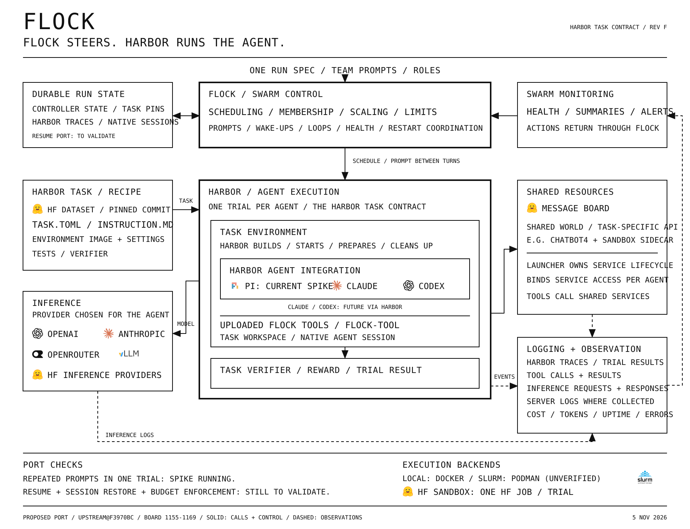

# flock

Host agent swarms (each agent a Harbor Trial) on Hugging Face Jobs, Slurm or a laptop: keep
them alive, prompt them, watch them. One controller, N worker jobs, up to 200
agents per worker. Declare a swarm in YAML and the controller keeps it running,
the way Kubernetes keeps pods running.

It is the layer under [msgboard](https://github.com/huggingface/msgboard) and
[swarmlab](https://github.com/huggingface/swarmlab): it hosts agents and exposes
a prompt API and an event stream, and leaves messaging and experiment design to
them.



## Features

- **Local mode:** `compute: local` and `flock launch spec.yaml` run the same spec on a laptop
  (background controller, workers as subprocesses, run bundle);
  `compute: hf-jobs` is the line that moves it to HF Jobs ([docs/local.md](docs/local.md)).
- **Declarative swarms:** a Harbor spec (YAML) names the run, its task, model server,
  agents and roles, resources and tools; `flock launch` compiles it into a swarm spec with
  one type per role (`harness: harbor`: each agent is a Harbor Trial running Pi).
  `launch`, `update` and `remove` edit the spec; a reconcile loop makes HF Jobs
  match it.
- **Stable agent identities:** agents get flock's random names (`amber-otter`), or consecutive
  `agent-001`, ... with `naming: consecutive-id` (docs/spawn.md "Names"). The same name
  keeps the same harness session and workdir across worker restarts.
- **Durable sessions:** workers sync each agent's session and workdir to a
  bucket and restore them on relaunch, so an agent resumes with its context
  on another worker. A failed resume is a visible fresh start.
- **Long-lived Trials:** an agent's Trial starts on its first prompt and stays up; each
  prompt is one Pi turn in it.
- **Health states:** agents are `working`, `idle`, `stuck`, `unknown` or
  `dead`; workers are `launching`, `running`, `draining`, `unknown` or `dead`.
  A type that crashes five times in a row is marked `crashlooping`.
- **Prompts and events:** `POST /agents/{name}/prompt` acks at once; results
  are read from the agent's event stream (pi session format v3, long-poll). A
  prompt to an agent whose worker is down is held and delivered after relaunch.
- **Usage and cost:** tokens per model per turn, cost from a price table, per
  agent and per swarm.
- **Open models:** `inference:` points the run at vLLM in a GPU job, the HF router or any
  OpenAI-compatible server, with prices pinned at apply and a preflight that checks each
  model can call tools. See [docs/open-models.md](docs/open-models.md).
- **Planned restarts:** workers live 24 h plus jitter by default, drain before
  their deadline, and the controller relaunches them with their agents
  restored. The herd never restarts all at once.
- **Spawning:** a leader agent creates, prompts and removes child agents of
  other roles with the `spawn.*` tools, under a `spawn:` policy (allowed types,
  caps, depth) and swarm `limits:`. Each agent calls the controller with its
  own scoped token, held by its worker. See [docs/spawn.md](docs/spawn.md).
- **Loops and budget stop:** a type's `loop:` re-prompts its agents (`every:
  turn_end` or a duration) while `while:` holds
  (`until`, `max_rounds`, `budget_usd`, `agent_usd`), then runs one `final:`
  round; `limits.budget_usd` stops the swarm. `flock stop --final` stops
  a loop with its final round. See [docs/loop.md](docs/loop.md).
- **Live changes:** `flock update <folder>` applies an edited experiment folder (spec,
  prompts, tools) to the running swarm and prints what changed; run it again after each edit. Agents take each change at their next turn, with a one-line note.
  See [docs/live.md](docs/live.md).
- **Board (optional):** the `message_board` resource gives the agents a msgboard board (local, or on a Space) through
  `message_board.*` tools, with posting rules enforced before the board is called; its @mentions
  wake loops (`loop.on: [message_board.mention]`). See [docs/comms.md](docs/comms.md).
- **Worlds (optional):** a world is an HTTP service holding the swarm's shared state (World
  API v1: `GET /manifest`, `POST /tools/<name>`, a shared secret); the `world` resource and
  its `world.*` tools reach it, each call carrying the agent's name.
  `python -m flock.world serve module:Class` serves a `flock.world.World` subclass.
  See [docs/world.md](docs/world.md).
- **Status page and CLI:** `/` shows every swarm with state chips and cost;
  `flock` wraps the HTTP API.

## Usage

Needs Python 3.12+ (Harbor's), an HF token with Jobs access, and the model server's key.

```sh
git clone https://github.com/huggingface/flock && cd flock
uv sync                              # Harbor comes with flock
```

Installing needs GitHub access to msgboard (a private dependency); jobs install it from the
`harbor-deps.tar` that `scripts/publish-wheel.sh` ships next to the wheel.

`uv sync` does not activate the environment, so the commands below go through `uv run` (or
run `source .venv/bin/activate` once). A bare `flock` may be util-linux's file-locking tool,
a different program; `uv run` also gives the scripts a Python with `huggingface_hub`.

### On your laptop: `flock launch`

The same spec with `compute: local` runs the controller and its workers on your machine, in the background
with a run bundle at the end (`flock status` to watch); no HF token or bucket needed for a
local model endpoint. See [docs/local.md](docs/local.md):

```sh
uv run flock launch spec.yaml
uv run flock prompt --swarm hello --type agent "Start on the task."
uv run flock stop hello --delete --yes   # ends the run and writes the bundle
```

### Examples

Each of these folders has a `spec.yaml` and a README (what it runs, tokens, cost, launch):

- `experiments/mini-swarm`: three agents greet each other on a Space board, each in an HF
  Sandbox; no Docker.
- `experiments/escape-room`: four agents solve an AgentEscapeBench room in local Docker,
  sharing a local board.
- `experiments/pybot`: the large example. A swarm in ten lanes builds a Python chatbot through
  pull requests to a shared world, on HF Jobs and HF Sandboxes; one agent per lane by default,
  the sizes of a 1,000-agent run in the spec.

### Run the controller

As an HF Job in the workers' network group (job mode; see
[docs/deploy-job.md](docs/deploy-job.md)). The wheel's directory also gets `harbor-deps.tar`
(msgboard's wheel and uv.lock's versions), which the controller job and the workers install from:

```sh
export HF_TOKEN=... FLOCK_TOKEN=$(openssl rand -hex 24)
uv run hf buckets create <you>/flock --private                # once: wheels and agent state
W=$(uv run scripts/publish-wheel.sh hf://buckets/<you>/flock/dist)   # needs GitHub access to msgboard
uv run scripts/deploy-job.sh "$W" --group <name>     # prints the job's two URLs
export FLOCK_URL=https://<job id>--7860.hf.jobs       # API through the jobs proxy
# the CLI sends HF_TOKEN to the proxy and FLOCK_TOKEN as X-Flock-Token;
# https://<job id>--7861.hf.jobs is the public, read-only status page
# (only with a huggingface_hub whose run_job has `expose_public`; else just the API; the launch says so)
uv run scripts/deploy-job.sh --down --group <name> "$W"   # teardown: cancel + delete its state
```

The HF Docker Space deployment (`scripts/deploy-space.sh`) is unsupported for now: its build
cannot install msgboard, a private GitHub repo (Dockerfile.controller).

Or locally:

```sh
FLOCK_TOKEN=... HF_TOKEN=... \
FLOCK_WHEEL_URL=hf://buckets/<you>/flock/dist/<rev>/flock-0.0.1-py3-none-any.whl \
uv run flock-controller          # http://127.0.0.1:7860
```

Workers bootstrap from a stock `node:22-bookworm` image: they install the
wheel from the bucket. Every secret a spec names (including each provider's `api_key_env`)
must be in the controller's environment.

| Your shell (`deploy-space.sh` reads) | Space secret / controller env | Spec `secrets:` |
| --- | --- | --- |
| `HF_TOKEN` | `HF_TOKEN` | `HF_TOKEN` (workers need it for the wheel and the bucket) |
| `FLOCK_TOKEN` | `FLOCK_TOKEN` | never: the controller passes it to workers itself |

### Declare and drive a swarm

```yaml
# demo.yaml: a Harbor spec on HF Jobs; experiments/pybot/spec.yaml is a complete one
name: demo
namespace: <you>
bucket: hf://buckets/<you>/flock/demo
compute: hf-jobs
model: huggingface/Qwen/Qwen3.8-27B:deepinfra
pricing: [0.2, 2.5, 0.2]
inference: {base_url: https://router.huggingface.co/v1, api_key_env: HF_INFERENCE_TOKEN,
            api_format: openai_chat_completions}
task:
  repo: https://huggingface.co/datasets/harborframework/terminal-bench-2.1
  dataset: terminal-bench-2.1@2.1.0
  selector: regex-log
  revision: 3e235dff6880252a587fa479c09bcb1e16edf2eb
agents: {count: 100}
environment: {backend: hf-sandbox}       # hf-jobs workers run each Trial in an HF sandbox
workers: {agents_per_worker: 50}
```

`backend: hf-sandbox` runs each Trial in an HF Sandbox: `environment.flavor` is its
hardware (default `cpu-basic`), it bills to the spec's `namespace` (unset: the HF token's account),
and its idle timeout is `turn_timeout` plus 60 s. The task needs a prebuilt public `docker_image`;
nothing is mounted, so no local board and no `spawn` resource. experiments/mini-swarm runs three
agents this way from a laptop, with a board on a Space: no Docker.

Model servers: [docs/open-models.md](docs/open-models.md). The vendored Harbor task-runner code
(config, launch, resources, the Pi harness, the tool runner) is in `src/flock/harbor/`, next to
flock's own Harbor glue (`spec.py`, `agent.py`, `envs.py`).

```sh
export FLOCK_URL=https://<you>-flock.hf.space FLOCK_TOKEN=...
uv run flock launch demo.yaml
uv run flock status demo                 # counts by type and state, cost
uv run flock prompt amber-otter "Report your progress."
uv run flock status amber-otter --events --follow  # agent.turn_started, agent.turn_ended, ...
uv run flock stop demo --release      # drain, sync every agent, free the workers
uv run flock launch demo              # resume
uv run flock stop demo --delete
```

Other commands: `status <swarm> [--type --state --parent --agent --events --watch --json]`
(docs/health.md), `stop <swarm> [--release|--final]`, `update <folder> [--check]`. `launch`
runs the preflight first when the spec has provider-backed models (`--skip-preflight` to
bypass); `update --check` runs it alone.

### HTTP API

`Authorization: Bearer $FLOCK_TOKEN` on every call.

| Call | Purpose |
| --- | --- |
| `PUT/GET/DELETE /swarms/{swarm}`, `GET /swarms` | apply, inspect, remove |
| `POST /swarms/{swarm}/preflight` | one tool-calling request per provider-backed model |
| `GET /swarms/{swarm}/agents?type=&state=&cursor=` | paginated agent list |
| `GET /agents/{name}` | one agent's state, pending prompts, cost |
| `POST /agents/{name}/prompt` | body `{text, timeout?, reply_to?}`; acks `queued` or `pending` |
| `POST /swarms/{swarm}/prompts` | body `{type, state?, text, timeout?, reply_to?}`: the prompt to every agent of a type in one request (`flock prompt --swarm S --type T [--state idle] TEXT`); acks counts. With `state: idle` agents that already have a pending prompt are skipped (`skip_pending`, counted in `skipped_pending`), so repeated calls never stack prompts |
| `GET /agents/{name}/events?after=&wait=` | event stream, long-poll |
| `GET /workers`, `GET /workers/{id}` | worker list and detail |
| `POST /agents/{parent}/spawn`, `DELETE /agents/{name}`, `GET /whoami` | spawn and remove child agents ([docs/spawn.md](docs/spawn.md)); agents call these with their own token |
| `GET/POST /swarms/{swarm}/loop`, `GET /swarms/{swarm}/events` | loop state per type and agent, `{type, action: start\|stop, final}`, the swarm-level event stream ([docs/loop.md](docs/loop.md)) |
| `GET /swarms/{swarm}/health`, `/health/history?since=&res=` | health snapshots ([docs/health.md](docs/health.md)) |
| `GET /`, `GET /healthz` | status page, health and request counters (no auth) |

## Tests

```sh
uv run pytest -q
uv run ruff check src tests experiments
```

No network, no real jobs: the Hub client and Harbor are faked (tiny real runs: tests/tinyrun.py).

## Limits

- Defaults: 50 agents per worker, at most 20 of them in a turn (`agents_per_worker`,
  `max_working_per_worker`).
- An HF Spaces edge in front of the controller rate-limits a large swarm's heartbeats; run the
  controller as a job in the workers' network group ([docs/deploy-job.md](docs/deploy-job.md)).
- Controller state (SQLite and event files) lives in `FLOCK_DATA`, `/data` in the controller
  image; in job mode it is synced to `FLOCK_STATE_URL`. Without either a restart wipes it:
  replicas come back from the spec, spawned agents do not.

Design and contracts: [docs/design.md](docs/design.md).
