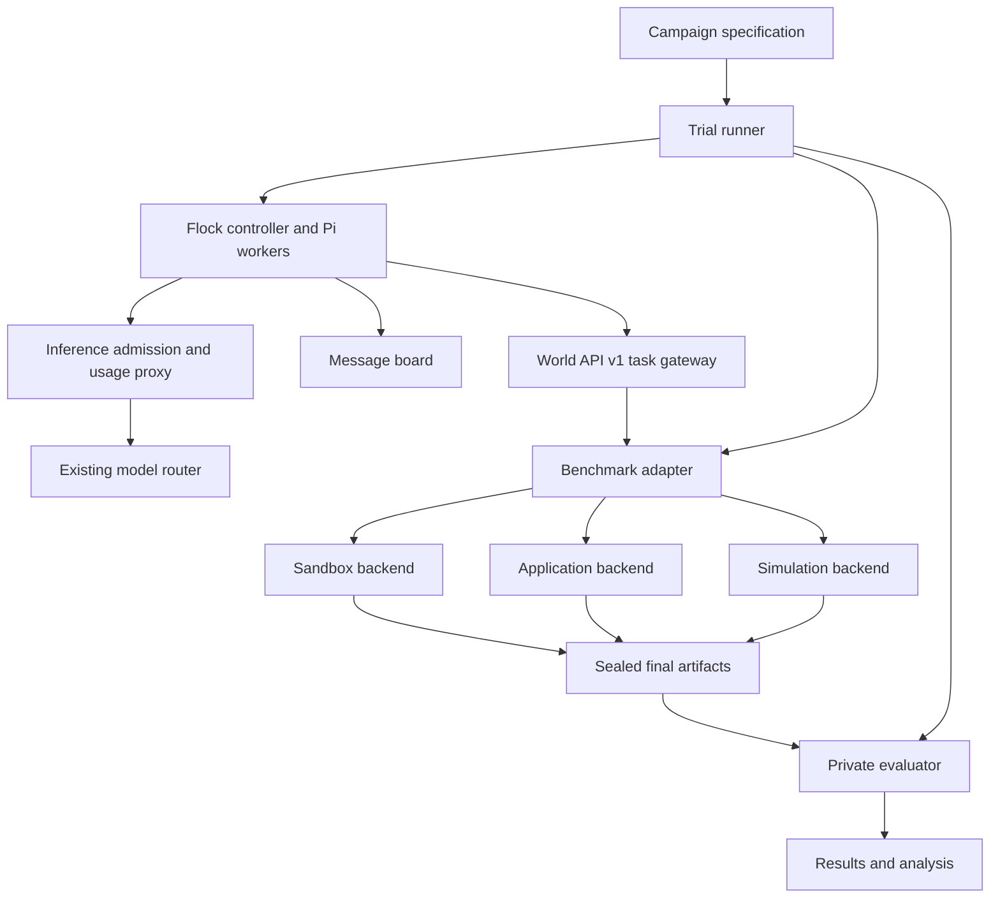

# Integrating diverse benchmarks with Flock

Design proposal, 2026-10-29. Companion to the
[task landscape](swarm-task-landscape.md), covering all 27 candidates.
This document proposes implementation; the interfaces, commands and configuration examples
marked proposed do not exist yet. No benchmark integration or workload is launched here.

## 1. Architectural decision

**Keep Flock responsible for agents; put benchmark lifecycle and grading in an experiment
runner; reuse three environment backends across small benchmark adapters.** Adding a dataset
should normally add an adapter and task metadata, without editing the controller, worker,
Pi implementation or Slurm launcher.

Use existing Flock mechanisms rather than building another agent framework:

| Concern | Owner |
| --- | --- |
| Agent processes, Pi sessions, routing identity, heartbeats and worker placement | Flock |
| Board messages, membership and existing private viewer | Existing communications stack |
| Task selection, trial matrix, aggregate budgets, lifecycle, grading and comparisons | Experiment runner |
| Resettable environment, observations, allowed actions and submission conversion | Benchmark adapter backed by an environment backend |
| Sandboxed commands, app instances, simulator processes and immutable artifacts | Environment backends |
| Benchmark task semantics, reference solutions and canonical grading | Upstream benchmark, called through the adapter |

This follows [Flock's design](../design.md): Flock hosts harnesses, while the experiment layer
owns scientific comparisons. [Swarmlab](../../../swarmlab/docs/DESIGN.md) already owns worlds,
metrics and budgets; do not create a competing generic scheduling/replay framework here.
However, its in-process World/Participant lifecycle is not interchangeable with long-running
external Pi sessions. Do not claim a thin HTTP wrapper provides full swarmlab round semantics.

Start as a focused Python package under `flock/experiments/benchmarks/`, exercised through
`python -m experiments.benchmarks`. Keep benchmark contracts independent of Flock internals.
After two representative integrations work, move reusable experiment contracts into swarmlab
and retain a Flock execution bridge. Until then, do not make swarmlab a mandatory Flock runtime
dependency or refactor either framework wholesale. Productionizing that move needs its own
interface review; it is not a prerequisite for the pilot.

## 2. One trial, three backends



The gateway is one agent-facing endpoint per trial, implementing the existing
[World API v1](../world.md). It need not be a separate container: initially it can run in the
trial supervisor process. Benchmark engines and arbitrary task code run in isolated processes
or containers. Grading is an experiment-runner operation, never an agent tool.

### A. Sandbox backend: work on artifacts

For repositories, terminals, scientific analysis, ML training and document tasks:

- Mount task inputs read-only. Give every agent private scratch space or a worktree. Publish
  selected files as immutable artifacts; maintain one explicitly selected submission.
- Expose bounded file operations and asynchronous command execution inside the task sandbox.
  A command returns a job handle; subsequent calls retrieve status and paginated output.
- Preserve upstream task images, dependencies, validation commands and submission formats.
  Reuse Harbor/HAL lifecycle or grader entry points where possible; Flock remains the agent
  implementation rather than nesting a second autonomous agent inside it.
- Permit a genuinely shared filesystem only as an explicit experiment mode. Defaults should
  prevent two agents accidentally overwriting the same source tree or notebook kernel.
- Private notebooks/kernels per agent; transfer code, data summaries and outputs through files.
  A shared live kernel is opt-in and serializes execution.

Use an existing supported container runtime, selected by capability checks. Docker-based
upstream tasks must not be declared Apptainer-compatible merely because this cluster supports
Apptainer. Where conversion changes mounts, nesting or networking, run the same reference
checks and record a distinct environment revision. Never hand agents a host Docker socket.

### B. Application backend: work in a shared service

For browser/API workflows and virtual EHRs:

- Allocate a private app stack/database namespace per trial, with a known initial snapshot.
  Cache images and static assets across trials; never reuse dirty task state.
- Create distinct agent sessions with the same task-authorized identity where upstream requires
  it. Preserve actual permissions; separate browser profiles do not imply separate task users.
- Use browser or API operations according to the benchmark's prescribed interface. Replacing
  a browser benchmark with direct database writes is a new experiment, not an optimization.
- Prefer upstream transactions/version checks. For adapters that need a single writer, grant
  a short-lived lease per mutable resource, with fencing epochs so expired holders cannot
  commit late. Read-only exploration may run concurrently.
- NPCs and external services are environment dependencies, not counted as swarm agents; their
  model settings, requests and costs must still be recorded.

### C. Simulation backend: work in a world

For science simulations, games, factories and operations:

- Map each task's observation/action loop to the gateway; keep simulator state authoritative.
  Native rewards may be agent-visible only where the benchmark permits them. Hidden final
  correctness remains evaluator-only.
- Pin seed, timestep policy, action order, player identities and information boundaries.
  For turn-based games enforce turn ownership; for simultaneous games buffer actions and
  commit at the configured tick/deadline. Do not let request arrival order redefine the game.
- Distinguish model agents from controllable actors. Advisory teams can control one scientist
  or two cooks without inventing unsupported additional actors.
- A serialization lock gives a well-defined event order, not deterministic live LLM behavior.
  Exact replay is available only when the engine, inputs and random state support it; otherwise
  provide an audit replay of recorded observations/actions.

Backends compose: an application task may include a sandbox for spreadsheets, and Factorio may
use a simulator plus a Python execution surface. Keep one authoritative session and evaluator,
not several competing task state machines.

## 3. Small adapter contract

Use plain Python protocols and dataclasses initially. The following is a **proposed conceptual
interface**, not an addition to `flock.models` or the World HTTP protocol:

```python
class BenchmarkAdapter(Protocol):
    def catalog(self, selection: TaskSelection) -> list[TaskRef]: ...
    async def prepare(self, task: TaskRef, resources: Resources) -> PreparedTask: ...
    async def start(self, prepared: PreparedTask, trial: TrialContext) -> TaskSession: ...
    async def evaluate(self, sealed: Submission, evaluator: EvalContext) -> Evaluation: ...

class TaskSession(Protocol):
    def tool_manifest(self) -> list[ToolSchema]: ...
    async def observe(self, caller: Caller) -> Observation: ...
    async def call(self, caller: Caller, tool: str, args: dict, op: Operation) -> dict: ...
    async def seal(self, reason: str) -> Submission: ...
    async def close(self) -> None: ...
```

Required records:

| Record | Minimum contents |
| --- | --- |
| `TaskRef` | Benchmark ID, upstream task ID, split, dataset revision, optional difficulty and variation/seed, source-group ID such as paper/capsule |
| `PreparedTask` | Verified image/artifact digests, evaluator revision, resource requirements, startup/reset recipe and allowed tools |
| `TrialContext` | Campaign/trial/attempt IDs, agent roster, actor mapping, seed, budgets, output root and credential references |
| `Operation` | Request ID, logical operation ID, caller, task-state epoch and deadline |
| `Submission` | Immutable artifact references or sealed state snapshot, task identity and seal time |
| `Evaluation` | Native metrics with direction/units, optional canonical success, evaluator version, validity and diagnostic evidence |

Capabilities are declared data: required modality, execution backend, external services,
GPU needs, native actors, checkpoint support and grading type. Validate them before any model
request. Optional checkpoint/restore and native completion notification use separate capability
interfaces; an unsupported feature must fail explicitly, not silently reset.

Keep `difficulty` optional and benchmark-native. CORE assistance level, DiscoveryWorld
Challenge and a SWE task's inferred hardness are different concepts. `scenario_index` is only
an index into a saved, ordered task manifest, never a stable cross-version task identifier.

Adapters should only translate formats and invoke upstream APIs. Avoid one class per task,
a universal numerical difficulty scale, benchmark-name branches in the controller, or a tool
that accepts arbitrary evaluator commands. Keep actual environment dependencies in their own
images rather than the Flock worker environment.

## 4. Agent-facing tools and control boundaries

Use Pi's [native Flock tools mode](../pi.md#native-flock-tools) as the default: `pi_tools_only:
true`, with explicit world and communications tools. Native host shell/file tools stay disabled;
the sandbox backend supplies benchmark-scoped equivalents. This is a concrete access boundary,
not a claim that the [tools-folder subprocess runner](../tools.md) is a security sandbox.

Expose only capabilities relevant to the selected task. Proposed common tool vocabulary:

| Group | Tools | Semantics |
| --- | --- | --- |
| Common | `task_observe`, `task_submit` | View allowed state; register a final artifact. Submission is not proof of success. |
| Files | `fs_list`, `fs_read`, `fs_write`, `fs_patch` | Paths resolve inside the caller's sandbox; bounded output; writes return a revision. |
| Execution | `exec_start`, `exec_status`, `exec_output`, `exec_cancel` | Handles and time/resource caps; no long HTTP request or host process execution. |
| Artifacts | `artifact_publish`, `artifact_fetch` | Immutable digest-addressed output; access determined by trial/arm policy. |
| Browser/API | Benchmark-native operations | Browser sessions or allowed API methods; no generic private database access. |
| Simulation | `sim_observe`, benchmark action names | Preserve upstream action semantics and agent-specific views. |

Tool names are examples to freeze during the first adapter; avoid colliding with reserved
`bash`/`done` or communications `read`/`post`. One Flock swarm has one configured World; combine
selected capabilities in this manifest rather than adding multiple World slots to the spec.

Trust caller identity only through the authenticated Flock gateway. Validate tool permissions,
resource ownership, operation epochs and paths again on the server. Never accept an agent ID
supplied in model arguments as authorization. Evaluator, reset, cancellation and budget
administration use a private control channel unavailable in the manifest. Scrub inherited
supervisor credentials before spawning task code; do not inherit the World process environment.

World transport has bounded calls/results. `exec_start` commits quickly; work runs under the
backend, not in an async HTTP handler that may disappear when the request is cancelled. Return
small excerpts and artifact handles rather than notebook dumps or entire browser histories.
The existing specialized workspace-upload extension is not a general large-dataset transport.

Flock already sends `X-Request-Id` and retries selected transient HTTP statuses. Persist request
results for transport retry deduplication. A newly generated model call gets a new request ID,
so use explicit operation/job/submission IDs for safe logical retries too. For app actions that
cannot be transactionally deduplicated, an uncertain outcome becomes `needs_reconciliation`;
inspect state before retrying. Do not promise exactly-once external side effects.

## 5. Trial lifecycle and artifact layout

A campaign expands to a frozen task matrix, then launches independent attempts:

```text
planned -> preparing -> ready -> running -> quiescing -> sealed -> evaluating -> finished
                    \-> setup_failed                 \-> evaluation_failed
running/quiescing can also terminate as timeout, cancelled, or infrastructure_failed
```

Persist each transition with a monotonic sequence number. Terminal correctness, execution state,
and accounting completeness are separate fields: a solved task may have incomplete accounting;
a completed process may have failed its task. Do not compress everything into one `success` flag.

Execution sequence:

1. Resolve/pin catalog, tools, images, task and evaluator; check access and runtime capabilities.
2. Prepare immutable assets; create private mutable state and a private timestamped board.
3. Start gateway, inference proxy and workers. Await explicit worker/environment readiness;
   only use a first-request barrier for experiments where simultaneous start is intended.
4. Start the measured clock and open request/action admission. Track environment health,
   agent activity, usage and outstanding work independently.
5. On final submission, permitted native completion, budget limit or timeout, close new model
   and action admission. Fence late task writes; resolve or cancel running commands under a
   bounded drain policy. Freeze candidate selection at this boundary.
6. Drain already admitted inference for usage, then stop agents. Seal stable artifacts/state;
   evaluate out of band; upload verified results; clean up owned resources in `finally`.

If an upstream grader is only defined at the end, do not repeatedly run it to detect early
success. Agent completion requests end the attempt according to the selected submission policy;
canonical scoring then decides success. For anytime curves, grade frozen checkpoints offline
only when snapshot semantics permit it.

Proposed attempt bundle:

```text
campaign/<campaign_id>/
  campaign.yaml                 # submitted specification
  tasks.json                    # ordered pinned selection
  manifest.json                 # attempts, scheduler IDs, status
  attempts/<trial_id>/<attempt_id>/
    resolved.json               # settings, source/image digests, seeds, identities
    lifecycle.jsonl
    model-requests.jsonl        # authoritative usage, no credentials
    actions.jsonl               # allowed observations/actions and artifact references
    flock/                     # existing Flock sessions/events
    artifacts/                 # published and sealed outputs
    evaluator/                 # private grader logs, never mounted into agents
    result.json
  analysis/                    # joined tables and plots
```

Keep live mutable databases on node-local disk. Upload consistent snapshots with a manifest
written last; verify object digests before declaring persistence complete. Buckets provide
artifacts and the existing board viewer, not a live shared POSIX database. Large datasets reside
in an immutable cache keyed by digest; neither tools bundles nor agent home snapshots carry them.

Board names: `<benchmark>-<task-slug>-<arm>-n<N>-r<trial>-<UTC>-<attempt-suffix>`, shortened to
service limits with a collision-resistant suffix. Store the full IDs in metadata. Preserve the
existing private Space/bucket policy. Reference the board in results, but store executable task
outputs in the attempt bundle rather than as board attachments by default.

## 6. Budgeting and comparison semantics

Extract the existing AgentEscape usage proxy as a shared experiment component only after its
pending accounting fixes stabilize. One proxy/admission ledger per attempt handles all swarm
requests, retries, compactions and selectors. Forward each Pi conversation's stable
`X-Session-ID` unchanged for router affinity; record agent-to-session mappings. Do not replace
it with a single shared trial ID. A forced new conversation gets a new session ID linked to
its predecessor.

For a hard aggregate token ceiling, reserve prompt tokens plus the allowed maximum output
before forwarding each concurrent request; reconcile with provider usage afterward. Use the
server's exact tokenizer/chat template including tools. If exact counting or a valid conservative
bound is unavailable, declare a soft budget with an explicit overshoot bound instead of claiming
hard enforcement. Refuse new admission when unresolved reservations consume the remaining
budget. Missing final usage is unknown, never zero; preserve its reservation conservatively.

Canonical totals count all input, including cached input once, and output, including reasoning
once. Keep provider breakdowns alongside normalized counts. Never sum proxy and Flock usage as
if they were separate charges: the proxy is authoritative; harness events cross-check it. Judge,
NPC and synthetic setup requests have distinct categories; report them separately and in total
cost without confusing them with solving tokens.

Budget limits cover aggregate task CPUs/GPU time, simulator steps, wall time and model tokens.
A 32-agent team must not quietly receive 32 times the training GPUs. Router slots and per-trial
request limits are admission controls, independent of board poll frequency or message rate.
Keep existing model settings in reusable execution profiles; do not bake an IP address or model
name into any benchmark adapter.

Communication arms:

- `single`: one model-driven member with the same task tools.
- `independent`: private candidate environments/artifacts/boards; a frozen non-oracle selector
  chooses the final candidate using permitted evidence. Default to a deterministic selector;
  if a model selector is used, include that member in N and count its calls and resources.
- `shared`: one task environment, allowed shared artifacts and communications; coordinator
  included in N if present. Tool, observation and actor permissions remain unchanged.

For fixed-actor games, compare advisory teams over the same actor slots; do not confuse those
results with native player-count scaling. For independent candidate worlds, record aggregate
simulation/tool compute and exclude hidden-score selection. Any necessary protocol adaptation
gets a name/version and is reported separately from upstream leaderboard results.

## 7. Configuration and launch experience

Introduce a small campaign specification owned by the experiment runner, **not new benchmark
fields on `SwarmSpec`**. Compile it into existing Flock specs and a private trial manifest.
The example below is proposed configuration, not runnable YAML today:

```yaml
version: 1
name: broad-tasks-cpu-pilot
execution_profile: profiles/pi-local-router.yaml
selection:
  benchmark: terminal_bench
  dataset_revision: "<pinned revision>"
  task_ids: [cancel-async-tasks, db-wal-recovery]
  split: pilot
matrix:
  arms: [single, independent, shared]
  agent_counts: [1, 2, 4, 8]
  trials: 3
  seed: 42
limits:
  tokens_total: 500000           # illustrative pilot value, not calibrated
  wall_seconds: 3600
  max_new_tokens: 16384
resources:
  task_cpus: 8
  task_memory_gib: 16
  task_gpus: 0
launch:
  backend: slurm
  max_active_trials: 4
```

Expansion rules: single uses N=1 once; independent/shared use N>1; repeated equivalent entries
are rejected. Task IDs must resolve at the pinned revision. `split: pilot` names our selection,
not an invented upstream split; record the source split separately. Sampling uses a saved seed
and writes the selected ordered IDs before launch. External credentials are references resolved
from existing private secret handling, never YAML values.

Proposed commands: `catalog`, `validate`, `prepare`, `run`, `submit`, `status`, `analyze`, `cancel`.
Validation is offline unless asked to check external readiness. Preparation downloads/builds
assets but makes no model calls. Reference gates are explicit, separately budgeted steps.
Submission records scheduler IDs transactionally and is idempotent for a given manifest.
Cancellation targets only jobs/resources recorded for that campaign.

Start with **one Slurm allocation per attempt**, running Flock in local mode inside it along
with the supervisor/gateway and permitted task containers. The inference router stays external.
This matches small experiments and simplifies process cleanup. It is distinct from Flock's
existing Slurm-worker backend: do not submit nested worker jobs accidentally. App stacks that
cannot run inside the allocation use explicitly allocated external services with trial-scoped
leases. Later, distributed workers can use existing `compute: slurm` with `world.url`; the runner
then owns service reachability and lifecycle, as [the Slurm contract](../slurm.md) requires.

Admission respects cluster CPUs/memory, task GPUs, app-stack capacity and measured router slots.
No GPU request is inferred from the model being GPU-served. A watchdog flags inactivity using
outstanding commands, upstream inference and environment progress, not merely quiet boards.

## 8. Mapping all 27 candidates

These mappings specify adapter work, not an assertion that every candidate is ready or licensed
for use. See the companion report for upstream links and release-specific restrictions.

| # | Candidate | Backend and adapter responsibilities | Gate / benchmark-specific detail |
| ---: | --- | --- | --- |
| 1 | SWE-bench | Sandbox; load issue/repository/image, apply one submitted patch, invoke upstream regression evaluator. | Pin split and base commit; keep hidden tests out of agent mounts; isolate candidate worktrees. |
| 2 | SWE-rebench V2 | Same repository adapter with its task metadata, image and log-parser loader. | Select executable instances; validate image and reference patch; preserve language and task-license metadata. |
| 3 | R2E-Gym | Repository adapter; map native gym reset/action and test results into the same submission lifecycle. | Separate task scoring from optional learned-verifier candidate selection. |
| 4 | Terminal-Bench | Sandbox; Harbor task/image loader and canonical verifier bridge. | Agent adapter launches/controls Flock; no nested Terminus agent. Pin suite version. |
| 5 | Endless Terminals | Offline generator/preparer produces frozen task images; execute through terminal adapter. | Generation is a separately budgeted job; initial/final tests and reference quality gate every selected task. |
| 6 | CORE-Bench | Sandbox; capsule loader, assistance-level input policy, canonical report output and HAL grading bridge. | CPU/GPU metadata; group levels by paper; verify supported container nesting. |
| 7 | ScienceAgentBench | Scientific sandbox; load verified artifacts, emit Python program, invoke execution and visualization graders. | Isolate model-judge credentials; retain dataset exceptions and no-redistribution requirements. |
| 8 | DiscoveryWorld | Simulation; scenario/difficulty/seed mapping, observations/actions, final state and conclusion extraction. | Begin with one actor; validate modality and grading; multiple actors require a new protocol gate. |
| 9 | ScienceWorld | Simulation; Python/JVM bridge, task/variation/simplification settings and native reward. | Pin engine version and distinguish simplification from task difficulty. |
| 10 | MLE-bench | Scientific sandbox; competition data/split loader, asynchronous training jobs and submission file grader. | Dataset access, fixed aggregate training compute, immutable hidden holdout and metric direction. |
| 11 | MLGym | Scientific sandbox; task-config and performance-metric bridge. | Disabled by default pending noncommercial terms and archived-dependency validation. |
| 12 | BixBench | Scientific sandbox; capsule/notebook data loader and question/answer extraction. | Pin release; preserve capsule grouping and per-question grader type; private kernels by default. |
| 13 | MedAgentBench | Application; private FHIR server reset, authorized REST tools and reference evaluator. | Verify external reference artifact and data terms; no real patient data; write ownership. |
| 14 | SecondState FAB | Document sandbox; read-only data room, evidence-linked response submission and rubric grading. | Version code/data/judge separately; keep rubrics hidden where required; test judge repeatability. |
| 15 | Vals Finance Agent | Application/tools; upstream search and filing retrieval, answer submission and platform grading. | Disabled until gated access and service credentials exist; record retrieved evidence for audit. |
| 16 | FinRL | Scientific sandbox plus offline simulator; frozen price data, strategy code and backtest metrics. | New task suite needed: dates, fees, constraints, baseline, holdouts and no live trading. |
| 17 | TheAgentCompany | Application + sandbox; service-stack reset, browser/terminal tools, task initialization and evaluator. | Per-trial app state; separate NPC model accounting; preserve task-authorized identities. |
| 18 | WorkArena/++ | Application; BrowserGym action/observation bridge and native validation. | Approved ServiceNow instance pool; exclusive task lease, clean reset, mandatory release. |
| 19 | WebArena | Application; website snapshots, BrowserGym-compatible browser sessions and upstream checks. | Do not replace UI tasks with direct backend writes; isolate session and site state. |
| 20 | AppWorld | Application + sandbox; bundled task loader, API execution and state-test evaluator. | Honor bundle terms and train/dev/test rules; preserve collateral-change checks. |
| 21 | Toolathlon | Application/tool proxy; pin original, Verified, sandbox or GYM variant and its native evaluator. | Disabled pending explicit license/access audit; do not mix mock-service results with original live apps. |
| 22 | TextArena | Simulation; environment-name config, player observations, action parser and native rewards. | Choose cooperative objectives; preserve hidden information and fixed opponents if applicable. |
| 23 | OpenSpiel | Simulation; game-specific textual view, legal-action mapping and utility extraction. | New language-agent wrapper/protocol; team utility, actor mapping and opponent policies explicit. |
| 24 | Overcooked-AI | Simulation; fixed layouts/ticks, observation encoding and native delivery reward. | Same actors, macro-actions and step budget across teams; advisory members are not extra cooks. |
| 25 | Factorio Learning Environment | Simulation + sandboxed REPL; factory state, Python-action bridge and production metrics. | Engine terms; multiplayer semantics; serialize world writes; separate logical ticks from wall time. |
| 26 | OR-Gym | Simulation; frozen inventory/routing instances, action constraints and native costs/rewards. | New prompts and benchmark protocol; compatibility tests for old dependencies; fixed demand seeds. |
| 27 | SUMO | Simulation; network/demand loader, constrained control tools and transport metric extraction. | New task suite and baseline; map/data terms, safety constraints and fixed demand/step budget. |

The first five repository/terminal entries should share most lifecycle code. Scientific entries
reuse execution and artifact handling but keep their native graders. Browser/API entries share
service leasing and reset, not a forced universal UI action schema. Simulations share transport,
identity and event recording, while retaining their own observation and action spaces.

## 9. Recovery and correctness

A worker restart does not imply the environment was restored. Maintain separate agent-session,
world-state and budget-ledger epochs. Resume only when all agree with one committed checkpoint;
otherwise terminate that attempt as infrastructure-failed and create a linked new attempt.
Never silently repeat a failed trial until it solves.

Checkpoint capability levels: audit-only, final-state export, or coherent resume. Declare the
level per adapter. Browser sessions, running training processes and external services often
cannot resume exactly. Retry setup before model admission; after admission preserve spent
usage and classify the interruption explicitly. Lost lifecycle hooks are not a recovery signal:
Flock documents them as best-effort hints.

On normal stop, freeze mutation admission, drain/cancel backend jobs, seal state, grade and then
release resources. If sealing fails, preserve artifacts and mark the result invalid; do not
grade a changing directory. Preemption saves whatever is consistent within its drain window,
but cannot manufacture a coherent snapshot of an unsupported external service.

## 10. Implementation order and acceptance gates

1. **Contracts and fake task:** implement catalog, lifecycle, bundles, sandbox job handles,
   gateway identity, terminal statuses and a fake evaluator. No real model or scheduler calls.
2. **Terminal-Bench and CORE-Bench:** prove shared artifact execution with distinct loaders and
   native graders. Include oracle/no-op gates and one fake-Pi integration before a real pilot.
3. **DiscoveryWorld and Overcooked:** prove the simulation profile, actor/agent distinction,
   seeded replay and asynchronous tool dispatch without controller changes.
4. **TheAgentCompany and WebArena:** prove application leasing, reset, browser sessions and
   service shutdown. Add BixBench and FAB on the established artifact backend.
5. **Remaining local adapters:** add repository/science/text-game loaders from the table.
   Add MLE-bench only with explicit task-training compute. Conditional/held entries stay
   discoverable but unrunnable until their access/license gates pass.
6. **Consolidation:** move reusable experiment contracts to swarmlab when demonstrated by
   real adapters; preserve Flock's hosting boundaries and version stored results.

Tests must cover behavior, not merely serialized class shapes:

- Reference solution succeeds; deliberately invalid submission fails; sealed output cannot
  change afterward; evaluator credentials/files never appear in agent tools or mounts.
- Two agents cannot cross private artifact boundaries; a shared publication is visible only
  after commit; stale leases and duplicate request IDs cannot repeat a write.
- Reset produces the same task state; simultaneous actions obey the selected commit policy;
  fixed actor count and observation permissions survive an agent-count sweep.
- Timeouts kill owned sandbox process groups; cancellation releases service leases; lost
  hooks and interrupted uploads cannot produce a falsely valid result.
- Concurrent request reservations respect the advertised budget mode; retries and compaction
  count once; missing usage remains unknown; client disconnect does not silently discard spend.
- Independent-arm selection cannot see hidden scores; coordinator/selector costs are counted;
  invalid and failed attempts remain in analysis denominators and status tables.
- Slurm tests fake `sbatch`, `squeue`, `sacct` and cancellation. Runtime smoke tests are separately
  invoked; unit tests never launch real jobs, fetch datasets or spend model tokens.

Success criterion: adding the next candidate from an already supported backend changes only
its adapter, pinned task recipe and contract tests. Flock core changes are justified only by a
missing generic host capability demonstrated across adapters—not by a benchmark's name.
