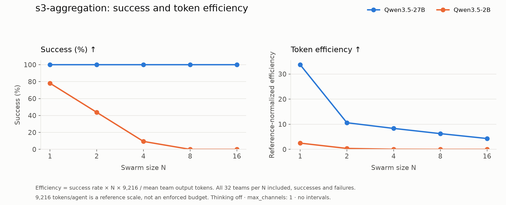

# Latest aggregation grid

Thinking off, `max_channels: 1`; 32 problems per swarm size and model. The source is
[`teams.csv`](teams.csv): all 320 counted teams, including task failures. Infrastructure
attempts set aside by the sweep are excluded, as in the success panel.



The efficiency panel follows [s³, Appendix M](https://arxiv.org/pdf/2611.08615#page=24):

```text
efficiency = success_rate * N * reference_tokens_per_agent / mean_team_output_tokens
```

`success_rate` is a fraction from 0 to 1. The mean includes successful and failed teams.
Count only generated/output tokens, including
tool calls and messages; input and cached-input tokens are excluded. This is a ratio of
aggregate success rate to mean token use, not an average of per-team ratios or a statistic
conditioned on success.

The reference scale is 9,216 tokens per agent (the paper's information-aggregation allowance:
8,192 work tokens plus 1,024 final-answer tokens). **These Flock runs did not enforce that
allowance**: they were limited by time and model calls. The reference makes the normalization
explicit; absolute values should not be interpreted as a matched-budget comparison with the
paper. Choosing another constant rescales the efficiency axis without changing either curve.
No uncertainty intervals are plotted.

Reproduce the PNG, SVG and numerical summary CSV from the original per-team data:

```sh
uv run experiments/s3-aggregation/sweep/efficiency.py \
  experiments/s3-aggregation/results/latest/teams.csv \
  --out experiments/s3-aggregation/results/latest/success-efficiency.png \
  --reference-tokens 9216
```
