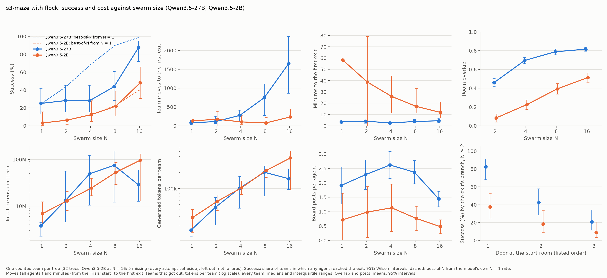

# s3-maze scaling sweep

The s³ paper's maze results (arXiv 2611.08615, Figure 4 bottom: success against swarm size;
Figure 5c: success by the branch that holds the exit; Appendix M: room overlap) with flock:
every tree of [`HuggingFaceSwarms/s3-maze`](https://huggingface.co/datasets/HuggingFaceSwarms/s3-maze)
(`a43f73c`) at N = 1, 2, 4, 8 and 16 agents, one team each, for `Qwen/Qwen3.5-27B` and
`Qwen/Qwen3.5-2B`: 320 teams, each its own flock run on the HF cluster (#123 at `73b70f0`). Only
the model and N change: the board rules, the loop, the limits and the 210-move budget are the
template's for every team. The raw runs are in the private
`HuggingFaceSwarms/s3-maze-results`; the sweep tooling is in the dataset's `flock/sweep/`.

| File | |
| --- | --- |
| `scaling.png` | eight panels against N, one series per model (below) |
| `by_n.csv`, `by_n.md` | per model and N |
| `teams.csv` | one row per team |
| `rows-27b.jsonl`, `rows-2b.jsonl` | metrics.py's row per team, with the driver's fields |
| `setaside-27b.md`, `setaside-2b.md` | the attempts that didn't count, by reason |
| `servers.jsonl` (the dataset's `results/` only) | each 27B server's requests, prompt tokens and prefix-cache hit rate per minute |

On flock's branch, `teams.csv` and the rows leave out each tree's exit branch, which start-room
door leads to the exit (the private task's answer). The private dataset's copies keep it.

## Results

| model | N | teams | success | 95% CI | best-of-N from N=1 | team moves to exit | minutes to exit | moves per agent | median input / output tokens per team | posts per agent | room overlap |
|---|---|---|---|---|---|---|---|---|---|---|---|
| Qwen3.5-27B | 1 | 32 | 8/32 (25%) | 13-42% | 25% | 80 | 3.5 | 181 | 3.8M / 17k | 1.9 | 0.00 |
| Qwen3.5-27B | 2 | 32 | 9/32 (28%) | 16-45% | 44% | 110 | 4.1 | 174 | 13.1M / 44k | 2.3 | 0.46 |
| Qwen3.5-27B | 4 | 32 | 9/32 (28%) | 16-45% | 68% | 276 | 2.5 | 175 | 49.5M / 102k | 2.6 | 0.70 |
| Qwen3.5-27B | 8 | 32 | 14/32 (44%) | 28-61% | 90% | 746 | 3.7 | 165 | 75.0M / 203k | 2.4 | 0.79 |
| Qwen3.5-27B | 16 | 32 | 28/32 (88%) | 72-95% | 99% | 1652 | 4.4 | 128 | 28.6M / 153k | 1.4 | 0.82 |
| Qwen3.5-2B | 1 | 32 | 1/32 (3%) | 1-16% | 3% | 132 | 58.2 | 52 | 6.9M / 29k | 0.7 | 0.00 |
| Qwen3.5-2B | 2 | 32 | 2/32 (6%) | 2-20% | 6% | 172 | 38.8 | 59 | 13.0M / 57k | 1.0 | 0.08 |
| Qwen3.5-2B | 4 | 32 | 4/32 (12%) | 5-28% | 12% | 102 | 26.0 | 49 | 24.5M / 103k | 1.1 | 0.23 |
| Qwen3.5-2B | 8 | 32 | 7/32 (22%) | 11-39% | 22% | 76 | 17.2 | 47 | 53.1M / 218k | 0.8 | 0.39 |
| Qwen3.5-2B | 16 | 27 (5 missing) | 13/27 (48%) | 31-66% | 40% | 235 | 11.8 | 39 | 96.6M / 376k | 0.5 | 0.51 |

Moves and minutes to the first exit are medians over the teams that got out; tokens are medians
over every team; overlap and posts are means. Best-of-N is 1 - (1 - p1)^N from the same model's
N = 1 rate.

**Missing:** 5 of the 2B grid's N = 16 teams (trees 07, 12, 15, 18 and 23) had no attempt that
counted after 5 tries, so they're left out of the rates rather than counted as failures. Their 25
attempts were all set aside for the infrastructure:

- 13 worker relaunches: 11 after the worker stopped answering, 1 for memory and 1 after a node
  failure;
- 2 workers out of memory;
- 8 late worker starts;
- 2 reclaimed controller nodes;
- tree 23's fifth try, cancelled at launch by the stop (below).

The kept 2B N = 16 runs may lean towards teams whose agents started no runaway process.

- **Qwen3.5-27B** stays at 25-28% from N = 1 to 4, then reaches 44% at N = 8 and 88% at
  N = 16. That's below best-of-N from its own N = 1 rate at every N >= 2. Teammates mostly walk
  the same rooms (overlap 0.46 at N = 2, 0.82 at N = 16). Its N = 1 rate is also the budget
  table's single depth-first search in listed door order (25%), the habit that keeps
  independent attempts from adding up.
- **Qwen3.5-2B** rises from 3% (one team) at N = 1 to 48% at N = 16. Its agents use 39-59 of
  their 210 moves, and 58 of its 155 counted teams were still working at the 80-minute cap,
  often with turns running into the 20-minute turn timeout. So time, not the move budget,
  bounds this model.
- **The first exit** comes 2.5-4.4 minutes in for 27B teams at every N. For 2B teams it falls
  from 58 minutes at N = 1 to 12 at N = 16.
- **Tokens per team** grow with N. 27B teams at N = 16 use fewer than at N = 8 because 88% of
  them stop on success within minutes.
- **The board:** about 2 posts per 27B agent and 1 per 2B agent, both lower at N = 16. Agents
  rarely @-mention, so the message graph is mostly empty.
- **The exit's branch matters** (Figure 5c's breakdown, N >= 2): 27B teams succeed 82% of the
  time when the exit is behind the start room's first listed door, 42% behind the second and
  21% behind the third. For 2B teams it's 38%, 18% and 9%.

## Set aside

Each attempt that didn't count ran again; `setaside-*.md` has the reasons per grid.

- **27B:** 47 attempts across 35 teams. 25 had an agent's server thrashing for 5+ minutes, and 8
  ran in the first hour while one GPU served the whole grid. 6 workers relaunched after a node
  failure, 5 controllers' nodes were reclaimed, 2 launches failed and 1 worker ran out of
  memory. Every 27B team has a run that counts.
- **2B:** 104 attempts across 66 teams. 25 workers stopped answering and were relaunched, 24
  relaunched after a node failure, and 23 started more than 2 minutes after their launch. 18
  controllers' nodes were reclaimed and 12 workers ran out of memory (6 of them relaunched). 2
  launches failed, one of them cancelled by the stop below. After four reruns of the five N = 16
  teams above, the sweep stopped without more tries. Bigger workers wouldn't help: on the last one, a
  runaway process took the worker's memory from 2 GB to 70 GB in 7 minutes, and the 38-CPU
  workers already waited 2-26 minutes for a node.

## Setup

- **Teams:** team.py's cluster spec at `a43f73c`: `stop_on_success` with the maze service's
  success check; one `#general` channel, wake on mentions and threads, at most 40 posts per
  agent, 5 s apart; the loop prompts again at each turn's end for at most 6 rounds or 45
  minutes; a turn times out after 20 minutes, at most 150 model calls per prompt. One worker
  on hopper-cpu per team runs its agents and their maze services in rootless podman, with a
  local board. The driver releases a team when its first exit is graded, when its agents stop,
  or 80 minutes after its launch.
- **Servers:** vLLM 0.32.0 on B200s (`--enable-auto-tool-choice --tool-call-parser qwen3_coder
  --reasoning-parser qwen3`). The 27B model ran on 15 server jobs, at most 14 at once. Each
  server took at most 9 to 19 agents (raised as servers came up, 15 from 17:43 CET), and each
  team ran on its own subset of the servers; otherwise a 27B agent's context outgrows its
  share of one GPU's 1.7M-token KV cache. The 2B model ran on one GPU, whose 13M-token cache
  holds the whole grid.
- **What counts:** a run whose worker started within 2 minutes of its launch, on one worker
  incarnation, with its controller kept, every agent's reward and move log and the board
  export, and no agent's server thrashing (prefix-cache hits under 50% while prefilling 200k+
  tokens) for 5 minutes or more. Anything else ran again, up to 4 times. What the model did
  (no move, no post, no exit, a hung turn) is a result.
- **2B workers:** runaway processes in the 2B agents' containers relaunched some workers, so the
  2B teams launched from 17:58 CET on got 2 CPUs (3.8 GB) per agent and a later memory guard.
  The task already caps each agent's container at 1 GB (Harbor's `mem_limit` from `task.toml`)
  and its maze service at 256 MB, but rootless podman in a hopper-cpu Slurm job can't enforce
  either. The job's cgroup isn't delegated, so containers get no cgroup of their own; in a test,
  a container capped at 256 MB allocated 1 GB. A normal agent with its service peaks at
  180-330 MB, so the 1 GB cap would hold if it were enforced.

**GPU time:** 50.0 B200 GPU-hours: 42.7 for the 27B model (15 server jobs) and 7.2 for the 2B
model (one), from 14:32 to 21:46 CET on 17 November 2026.

| job | server | ran (CET) | GPU-hours |
| --- | --- | --- | ---: |
| 408377 | 27B, port 8000 | 14:32-15:41 | 1.16 |
| 408646 | 27B, 8011 | 15:23-18:48 | 3.41 |
| 408647 | 27B, 8012 | 15:23-18:31 | 3.12 |
| 408648 | 27B, 8013 | 15:23-18:48 | 3.41 |
| 408649 | 27B, 8014 | 15:23-18:48 | 3.41 |
| 408650 | 27B, 8015 | 15:23-18:45 | 3.35 |
| 408765 | 27B, 8185 | 15:37-18:27 | 2.85 |
| 408766 | 27B, 8221 | 15:37-18:46 | 3.15 |
| 409337 | 27B, 8301 | 16:16-18:54 | 2.62 |
| 409338 | 27B, 8302 | 16:16-18:29 | 2.22 |
| 409339 | 27B, 8303 | 16:16-19:35 | 3.30 |
| 409401 | 27B, 8401 | 16:30-18:48 | 2.29 |
| 409402 | 27B, 8402 | 16:30-19:35 | 3.08 |
| 409403 | 27B, 8403 | 16:30-19:35 | 3.08 |
| 409404 | 27B, 8404 | 16:30-18:48 | 2.29 |
| 408378 | 2B, 8001 | 14:32-21:46 | 7.24 |

## How it differs from the paper

| | s³ (maze) | here |
| --- | --- | --- |
| Agents | Qwen3-1.7B trained with RL at N = 4 (and its controls) | `Qwen/Qwen3.5-27B` and `Qwen/Qwen3.5-2B`, prompted, not trained |
| Harness | `move`, `look`, `message`, `read_messages`, `check_notifications` tools; notifications interrupt | Pi in a container per agent: `maze look` / `maze move` and flock's board tools through its shell; one `#general` channel, wakes on mentions and threads; flock's loop prompts again at each turn's end |
| Budget | 8,192 work tokens per agent, no move limit | 210 moves per agent and wall time (a 45-minute loop, 20-minute turns, 80 minutes per team), no token allowance |
| Efficiency | token efficiency (solve rate / share of the allowance used) | tokens per team, and moves and minutes to the first exit (no allowance to divide by) |
| End | the first exit ends the episode at once | the first exit ends the run through flock's success check, polled every 30 s |
| Sizes | N = 1, 2, 4, 6, 8, 12, 16 | N = 1, 2, 4, 8, 16 |
| Problems | 32 held-out trees x 6 seeds, mean ± SE | 32 trees (seed 115) x 1 attempt, 95% Wilson intervals over trees |
| Baseline | solo-trained best-of-N, a no-communication control | best-of-N computed from the same model's N = 1 rate (independent attempts); no board-off control (a follow-up) |
| Observation | room, doors, exit, arrived from, dead-end notice | the same, plus the moves left |
| Message graph | delivery concentration and reciprocity of `message(to)` calls | posts per agent; edges only for @-mentions and DMs on the board |
| Serving | not a factor | shared vLLM servers: the 27B grid needed a per-server cap and a thrash rule to keep the time limit from deciding runs |
