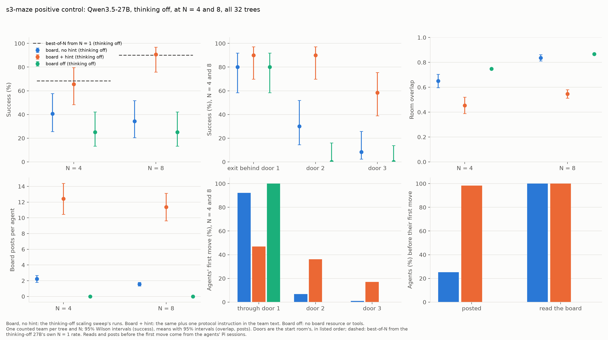

# s3-maze positive control (thinking off)

Can flock's board register coordination gains in the maze when agents are told how to
coordinate? `Qwen/Qwen3.5-27B` with thinking off, on all 32 trees of
`HuggingFaceSwarms/s3-maze` (`a43f73c`) at N = 4 and 8, one team each, in three conditions. Only
the condition changes: the dataset, the 210-move budget, the loop, the limits and the board rules
are the scaling sweep's.

- **Board, no hint (thinking off):** the thinking-off scaling sweep's N = 4 and 8 runs
  (`../rows-27b-thinking-off.jsonl`).
- **Board + hint (thinking off):** the same spec plus `team_file: hint.md`, which flock appends
  to each agent's instructions:
  > Before you go through a door, read the board and post which door you are taking; pick one no
  > teammate has claimed; post when a branch is a dead end.
- **Board off (thinking off):** no `message_board` resource, so no board tools. The task's
  instruction.md still mentions the board, since the dataset is unchanged.

| condition | N | success (95% CI) | best-of-N | success by exit door 1 / 2 / 3 | room overlap | posts per agent | first move through door 1 / 2 / 3 | posted / read before first move |
|---|---|---|---|---|---|---|---|---|
| board, no hint (thinking off) | 4 | 13/32 (41%, 26%-58%) | 68% | 8/10, 3/10, 2/12 | 0.65 | 2.2 | 90% / 9% / 2% | 36% / 100% |
| board, no hint (thinking off) | 8 | 11/32 (34%, 20%-52%) | 90% | 8/10, 3/10, 0/12 | 0.84 | 1.6 | 93% / 6% / 1% | 20% / 100% |
| board + hint (thinking off) | 4 | 21/32 (66%, 48%-80%) | 68% | 8/10, 9/10, 4/12 | 0.45 | 12.4 | 63% / 32% / 6% | 98% / 100% |
| board + hint (thinking off) | 8 | 29/32 (91%, 76%-97%) | 90% | 10/10, 9/10, 10/12 | 0.55 | 11.4 | 39% / 38% / 23% | 99% / 100% |
| board off (thinking off) | 4 | 8/32 (25%, 13%-42%) | 68% | 8/10, 0/10, 0/12 | 0.75 | 0.0 | 100% / 0% / 0% | 0% / 0% |
| board off (thinking off) | 8 | 8/32 (25%, 13%-42%) | 90% | 8/10, 0/10, 0/12 | 0.87 | 0.0 | 100% / 0% / 0% | 0% / 0% |

Best-of-N is 1 - (1 - 0.25)^N from the thinking-off 27B's N = 1 rate (8/32), the paper's
independent-attempts baseline. "Exit door" is the start-room door (in listed order) behind which
the exit lies: 10, 10 and 12 trees. "First move" is the door each agent's first move took.
"Posted / read before first move" comes from each agent's Pi session (its tool calls in order).

## What it shows

- **The env registers coordination.** With the hint, success rises from 41% to 66% at N = 4 and
  from 34% to 91% at N = 8, up to best-of-N (68%, 90%). Success is even across doors at N = 8
  (10/10, 9/10, 10/12, against 8/10, 3/10, 0/12 without the hint), overlap falls (0.84 to 0.55
  at N = 8), and first moves spread over the three doors (39/38/23%, against 93/6/1%).
- **Board off is the floor:** 25% at both sizes, every agent's first move through door 1, and
  success only when the exit is behind it (8/10, 0/10, 0/12). That is the budget table's single
  depth-first search in listed door order: without the board, N copies of the same search add
  nothing.
- **The hint matches best-of-N but doesn't beat it.** At N = 4 the claims cluster on the first
  two doors (63/32/6% of first moves), and teams find an exit behind door 3 in 4 of 12 trees.
  A perfect four-way split would always find it within the budget, so N = 4 has headroom left.
- **Without the hint, the limit is timing, not board reads.** Every agent read the board before
  its first move, but only 20-36% posted first, so most read an empty board at the same moment
  and all took door 1. With the hint, 98-99% posted their claim first. Posts stayed well under
  the board's cap (about 12 per agent on average, against 40).

## Set aside

Each attempt that didn't count ran again; `setaside-hint.md` and `setaside-noboard.md` have the
reasons.

- **Board + hint:** 9 attempts across 9 teams. 3 controllers' nodes were reclaimed, 2 workers
  relaunched after a node failure, 2 ran out of memory, 1 launch failed and 1 worker never
  started.
- **Board off:** 8 attempts across 7 teams. 5 controllers' nodes were reclaimed, 1 worker
  relaunched after a node failure, 1 after it stopped answering, and 1 ran out of memory.
- Every team in both conditions has a run that counts. The baseline's set-asides are the
  thinking-off sweep's (`../setaside-27b-thinking-off.md`).

## Setup and GPU time

Each condition ran on its own vLLM servers with `enable_thinking` false: 8 servers each at first,
then board-off took over the hint's 5 remaining servers and 3 new ones once the hint grid was
done. At most 12 agents ran per server, each team on its own subset of its condition's servers,
and none thrashed. The rule for what counts is the sweep's: an on-time, single-incarnation
worker, with every reward, move log and board export. The positive control used 37.3 B200
GPU-hours (21 server jobs; per job in `../README.md`). A first, thinking-on attempt was stopped
after 28 minutes, when the thinking default came to light, and used 7.7 more.

| File | |
| --- | --- |
| `control.png`, `control.csv`, `control.md` | the figure and the per-condition table |
| `rows-hint.jsonl`, `rows-noboard.jsonl` | metrics.py's row per team (without each tree's exit branch) |
| `setaside-hint.md`, `setaside-noboard.md` | the attempts that didn't count, by reason |
| `timing.jsonl` | per agent: first move, first post, and whether it read and posted before its first move |
| `specs/hint/`, `specs/noboard/` | one team's spec per condition (`maze-t01`, N = 4), with `hint.md` |
| `scripts/` | the driver wrapper that applies a condition, the timing analysis and the figure |

The raw runs, with every agent's Pi session, are in the private
`HuggingFaceSwarms/s3-maze-results` under `control-thinking-off/`.
