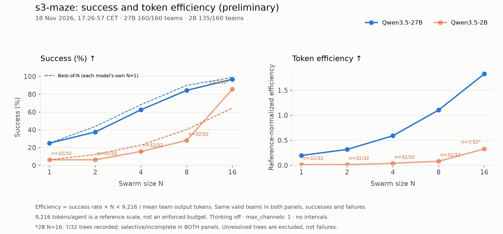

# Latest maze results (preliminary)

Captured **18 November 2026, 17:26:57 CET** from a read-only snapshot. The 27B grid is complete; 2B remains incomplete.

| Model | N | Successes/teams | Mean team output tokens | Efficiency |
|---|---:|---:|---:|---:|
| Qwen3.5-27B | 1 | 8/32 | 11,697.688 | 0.1970 |
| Qwen3.5-27B | 2 | 12/32 | 21,763.156 | 0.3176 |
| Qwen3.5-27B | 4 | 20/32 | 39,020.188 | 0.5905 |
| Qwen3.5-27B | 8 | 27/32 | 56,355.219 | 1.1039 |
| Qwen3.5-27B | 16 | 31/32 | 78,241.250 | 1.8257 |
| Qwen3.5-2B | 1 | 2/32 | 37,394.500 | 0.0154 |
| Qwen3.5-2B | 2 | 2/32 | 77,499.344 | 0.0149 |
| Qwen3.5-2B | 4 | 5/32 | 145,589.500 | 0.0396 |
| Qwen3.5-2B | 8 | 9/32 | 254,271.500 | 0.0816 |
| Qwen3.5-2B | 16 | 6/7 | 386,186.143 | 0.3273 |

**2B N=16 includes only 7/32 trees (6/7 successes). Completion is selective: neither panel is a final or unbiased full-grid estimate.** Unresolved teams are excluded, not failures. Both panels use exactly the same model/N cohort, including successful and
failed valid teams. Dashed success references use each model's own observed N=1 rate;
independence is a descriptive assumption. No uncertainty intervals are plotted.

## Metric and exact token evidence

`efficiency = success_rate * N * 9216 / mean_team_output_tokens`.

Only generated/output tokens count, including tool calls and messages; input/cached-input
tokens are excluded. The arithmetic mean includes **all** captured valid teams, including
failures. This is a ratio of aggregate success to mean usage, not a mean of per-team ratios
or a statistic conditioned on success. **9,216 tokens/agent is a reference scale, not an
enforced maze budget**; changing it rescales the axis. These runs use moves/time limits.

[teams.csv](teams.csv) retains exact integer per-team output totals. [token-audit.csv](token-audit.csv)
records every raw exported Harbor `result.json` SHA-256 and exact output evidence;
every Trial/agent/team sum matches the accepted row. Executed Trials use explicit integer
`agent_result.n_output_tokens`. 62 setup failures are classified as proven zeros:
both execution/context fields are null and the traceback proves failure in pre-execution
`_prepare`/`_setup_agent`. Harbor initialises those fields before calling the agent.
At evaluated Flock `03ec1dd`, Pi `usage.output` is summed into that field in
`src/flock/harbor/agent.py` (including tool calls/messages). There are no rounded-median
estimates. Other missing token fields abort the capture, never silently change the cohort;
explicit zero-output teams remain included (a zero-mean group would make efficiency undefined).

[success-efficiency.csv](success-efficiency.csv) preserves exact integer group output sums,
team/success/failure counts, means and computed efficiencies. [capture.json](capture.json)
holds the capture time, cohort/audit hashes, source row hashes, task/source revisions and
actual collaboration instructions. [attempts.csv](attempts.csv) contains deduplicated attempt
records, including any eventually accepted attempts; it is not a model-failure list.

## Setup and limitations

Actual evaluated conditions: Qwen3.5-27B/2B, thinking off, same door-claiming/dead-end protocol
hint, one visible `#general` channel (`max_channels: 1`), mentions and no agent DMs. Raw grid
names remain `27b-hint`/`2b-hint`. Each team searches one of 32 fixed 391-room trees, at
N=1,2,4,8,16, with 210 moves per agent; a service-owned success check stops at the first exit.
The example's Qwen3.8 default is overridden by the evaluated Qwen3.5 models.

Evaluated source: `03ec1dd9be659bde3751d37e393d014cdd8e5061`; unchanged task pin:
`3b6c363d92626bd4d97a7ca89964fb850982d9ab`. Final results and tooling re-pin remain pending.
Infra exclusions (late starts, incomplete evidence, multiple incarnations) are retried;
model failures remain results. Rootless Podman cannot enforce container memory caps.
The 2B minute-delta cache log starts at 16:17 CET on 18 November; earlier vLLM logs cannot
establish absence of thrashing. No causal communication/hint effect is established.

The metric and styling follow [aggregation 19eca5c](https://github.com/huggingface/flock/blob/19eca5c7745c48f194f07dccb56d280995d49161/experiments/s3-aggregation/sweep/efficiency.py).
The 27B allocations total 15.112 B200 GPU-hours; final 2B allocation cost is pending.

## Reproduce

`uv run efficiency.py teams.csv --capture capture.json --out success-efficiency.png`
regenerates the PNG, SVG and numeric CSV using only this captured cohort. `capture.py`
can take a fresh read-only capture when private raw run files are available. The snapshot
was processed in hopper-cpu job `432547`; live files/jobs were untouched.
Raw runs remain private in [HuggingFaceSwarms/s3-maze-results](https://huggingface.co/datasets/HuggingFaceSwarms/s3-maze-results).

🤖 Generated with [Codex](https://openai.com/codex/)
