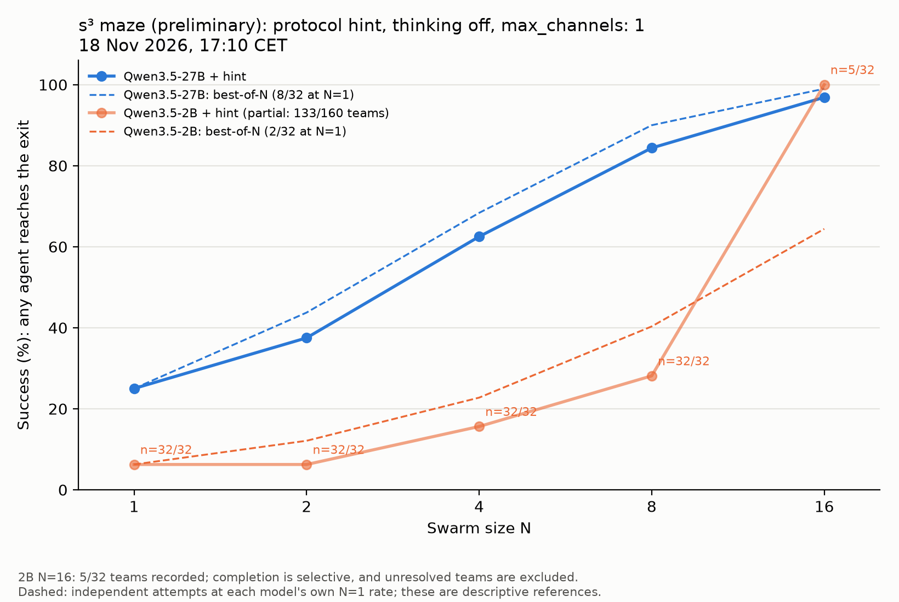

# Maze sweep: preliminary protocol-hint results

Captured **18 November 2026 at 17:10:56 CET** from a read-only snapshot. The 27B grid is complete (160/160 teams);
the 2B grid has **133/160** recorded teams and remains preliminary.

| Model + protocol hint | N=1 | N=2 | N=4 | N=8 | N=16 |
|---|---:|---:|---:|---:|---:|
| Qwen3.5-27B | 8/32 | 12/32 | 20/32 | 27/32 | 31/32 |
| Qwen3.5-2B | 2/32 | 2/32 | 5/32 | 9/32 | 5/5 |

Cells are successes/completed teams, targeting 32 trees per point. **The 2B N=16 point
contains only 5/32 trees: 5/5 is a selective incomplete result,
not a final or unbiased estimate.** Unresolved teams are excluded, not model failures.
Each 2B point shows its recorded count. Completion can depend on infrastructure and outcomes.

Both models have thinking off, receive the same door-claiming/dead-end hint, and share one
visible `#general` channel (`max_channels: 1`) with mentions and no agent DMs. Each team
searches one of 32 fixed 391-room trees with 210 moves per agent, at N=1,2,4,8,16. The first
agent out ends the run through a service-owned success check. The example's Qwen3.8 default
is overridden by the evaluated Qwen3.5 models.

The figure has plain points/lines and no intervals. Dashed best-of-N references are
`1-(1-p1)^N`, using each model's own N=1 hint rate (27B: 8/32; 2B: 2/32).
They assume independent attempts at one success probability, ignoring tree heterogeneity
and search correlation. These results alone do not establish a communication or hint effect.

## Provenance and exclusions

Evaluated Flock source: `03ec1dd9be659bde3751d37e393d014cdd8e5061`; task dataset pin:
`3b6c363d92626bd4d97a7ca89964fb850982d9ab`. Final results and a tooling re-pin are pending.
The snapshot verifies model, tree, N, task revision, board rules, hint and one worker
incarnation for every captured row. [teams.csv](teams.csv), [by_n.csv](by_n.csv) and
[capture.json](capture.json) preserve the metrics, counts, timestamp and row-file hashes.
[attempts.csv](attempts.csv) contains deduplicated attempt records, including any eventually
accepted attempts; it is not a list of model failures.

| Grid | Distinct excluded runs | Discard log records | Repeated records |
|---|---:|---:|---:|
| 27B + hint | 15 | 15 | 0 |
| 2B + hint | 184 | 249 | 65 |

Infrastructure attempts with late starts, multiple incarnations or incomplete evidence are
set aside and retried; model failures remain results. Oversized N=16 workers (38 CPUs /
72,200 MB) caused late starts; continuation uses 22 CPUs / 41,800 MB with unchanged tasks
and acceptance criteria. Rootless containers cannot enforce their memory caps.

The 2B minute-delta cache log begins only at 16:17 CET on 18 November. Preserved earlier
vLLM logs are supporting evidence, not reconstructed samples or proof that no thrashing
occurred. The completed 27B inference allocations total 15.112 B200 GPU-hours; final 2B
allocation cost is pending. Counts include only recorded teams, while allocation cost
includes warm-up, idle time and infrastructure retries; CPU time is excluded.

## Reproduce

Run `uv run report.py` here to redraw the one figure and regenerate the numeric summaries
from the saved `teams.csv` and `capture.json`; it does not read the running sweep. To take
a new capture, use `--runs SNAPSHOT --out OUTPUT` with a read-only hint-row/spec snapshot.
This capture was rendered in hopper-cpu job `431427`. No live sweep
files or jobs were changed. Raw runs remain private in
[HuggingFaceSwarms/s3-maze-results](https://huggingface.co/datasets/HuggingFaceSwarms/s3-maze-results).

🤖 Generated with [Codex](https://openai.com/codex/)
